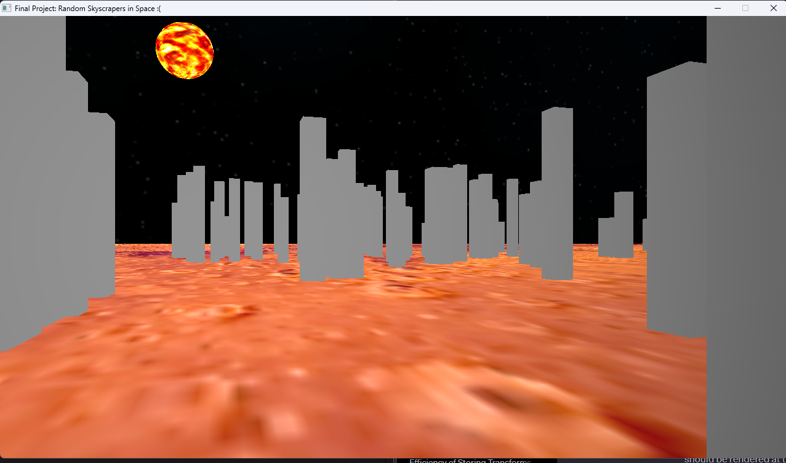

# SDL3 / OpenGL Graphics Engine

A C++ graphics-engine project built around SDL3 and OpenGL. It began as a
computer-graphics course project and currently demonstrates a real-time scene
with a skybox, textured ground, a grid of buildings, and a textured sphere.



## What is here

- SDL3 window and OpenGL context setup, with GLAD for OpenGL function loading.
- A renderer, camera, transforms, and a hierarchical scene graph.
- Geometry and vertex-buffer abstractions, including a generated grid.
- GLSL shader loading and basic diffuse-texture rendering.
- PPM textures, OBJ meshes, and a cubemap skybox.
- Sample models and textures under [`common/`](common/).

This is an experimental learning project, not yet a general-purpose engine.
The default scene and many asset and shader paths are currently specified in
the application code.

## Build and run

The build script expects to be run from the `engine` directory. It invokes
`g++` in C++20 mode and gets SDL3 compiler/linker flags from
`pkg-config sdl3`.

Prerequisites:

- A C++20-capable GNU `g++` toolchain.
- SDL3 development files and a working `pkg-config` entry named `sdl3`.
- On Windows, the build script is configured for MinGW; the SDL3 runtime DLLs
  are in `engine/lib`.

From the repository root:

**Windows (PowerShell):**

```powershell
cd engine
py build\build.py
.\engine.exe
```

**Linux or macOS:**

```sh
cd engine
python3 build/build.py
./engine
```

Run the executable with `engine` as its working directory. The current scene
loads shaders from `./shaders` and models/textures from `../common`, so running
it from a different directory can prevent those assets from being found.

## Project layout

```text
graphics_engine/
├── common/                 # Shared sample models, textures, and cubemap faces
│   ├── cubemap/
│   ├── objects/
│   ├── textures/
│   └── thirdparty/
├── engine/
│   ├── build/build.py      # g++ build script
│   ├── include/            # Engine headers, GLAD, and Khronos headers
│   ├── lib/                # Runtime libraries used by the Windows build
│   ├── shaders/            # GLSL shaders
│   └── src/                # Engine implementation and application entry point
└── README.md
```

## Current interaction

The SDL event loop handles window-close events and forwards mouse-motion events
to the camera. The keyboard camera-movement handlers are currently commented
out, so movement controls should not be assumed to be available. The scene is
created directly in `SDLGraphicsProgram::Loop()` rather than loaded from a
user-editable scene file.

## Review notes and proposed improvements

These are recommendations based on the current code, not features that have
already been implemented.

### 1. Reliability and rendering correctness

- **Make initialization failure fatal and actionable.** SDL, context, and GLAD
  setup currently accumulates errors, but construction continues. Return an
  explicit failure to the application and avoid entering the render loop if
  setup fails.
- **Make GPU and scene lifetimes explicit.** Replace owning raw pointers with
  RAII ownership (`std::unique_ptr` where ownership is exclusive), including
  the renderer's cameras and scene root. Ensure the OpenGL context is destroyed
  before SDL shuts down and GPU resources are released while a context is
  current.
- **Allow transform-only scene nodes.** `SceneNode::Update()` and
  `SceneNode::Draw()` visit children only when the node has an object. Separate
  node traversal from optional renderable behavior so empty grouping nodes work
  consistently.
- **Guard invalid camera access.** `Renderer::GetCamera()` currently does not
  safely handle an out-of-range index. Return a checked reference/pointer or
  report the error explicitly.
- **Align OpenGL state with the requested core profile.** The application asks
  for an OpenGL 3.3 core context but calls `glEnable(GL_TEXTURE_2D)`, a legacy
  fixed-function state. Remove that state toggle and check the renderer on a
  core-profile context.
- **Surface asset and shader failures.** Propagate file-read, image-decode,
  shader-compile, and program-link failures to the caller with the relevant
  path and diagnostic. Do not silently continue with unusable resources.

### 2. Performance

- **Measure before optimizing.** Add frame-time and draw-call counters, then
  profile representative scenes to establish where CPU and GPU time are spent.
- **Reuse meshes, textures, and shaders.** Scene nodes currently create their
  own shader, and objects own texture/buffer state. Introduce shared resource
  handles or a small asset cache so repeated assets are loaded and uploaded
  once.
- **Reduce repeated draw work.** Cache shader uniform locations instead of
  looking them up by name for each update. Group compatible draws by material;
  if profiling shows repeated city geometry is a bottleneck, share its mesh and
  consider instanced drawing.
- **Add visibility culling where it pays off.** Frustum-cull scene bounds before
  issuing draw calls as scene size grows; keep this behind measurements rather
  than adding complexity to the current small demo.
- **Use texture mipmaps effectively.** Textures generate mipmaps but currently
  use `GL_LINEAR` as the minification filter. Select a mipmapped minification
  filter for assets that benefit from it, and verify filtering and wrap modes
  per texture type.
- **Update the viewport on resize.** Track drawable window dimensions and
  update the viewport and projection aspect ratio instead of relying on the
  renderer's initial fixed dimensions.

### 3. Refactoring for extensibility

- **Separate application setup from engine systems.** Move default-scene
  construction and asset paths out of the SDL event/render loop into a scene
  builder or configuration. Keep SDL window/input code, scene management, and
  rendering responsibilities distinct.
- **Make scene ownership and traversal uniform.** Use a consistent child-node
  ownership API, prevent accidental duplicate parenting, and keep update/draw
  traversal independent of whether a node itself has a mesh.
- **Introduce reusable materials.** Represent shader, textures, and material
  parameters as shared resources rather than storing an effectively
  single-texture rendering path on each `Object`. This creates a clean path to
  multiple materials and shader variants.
- **Harden and define asset formats.** The OBJ loader currently reads only
  three face vertices and ultimately binds a fixed tile texture; it should
  triangulate polygon faces, handle supported OBJ index forms and normals, and
  apply material assignments consistently. The image loader should validate
  dimensions and pixel data and clearly document or broaden its PPM support.
- **Centralize asset path resolution.** Resolve paths relative to a known asset
  root (or a scene/config file) instead of the process working directory, and
  return useful errors for missing files.
- **Keep abstractions proportional to need.** A resource cache, scene builder,
  and material representation address current extension points; a generic
  multi-backend renderer is only worthwhile if another graphics API becomes a
  real requirement.

### 4. User experience

- **Provide dependable navigation.** Enable keyboard movement, use elapsed
  frame time so movement speed is independent of frame rate, and make mouse
  look sensitivity configurable. Add mouse capture/release and a reset-camera
  action.
- **Explain controls in the application and README.** Display a concise
  controls hint or help overlay so users can discover navigation without
  reading the source.
- **Give the demo useful defaults.** Add a clear starting camera position,
  sensible scene framing, and a way to restore the initial view.
- **Make failures understandable.** Show which asset or shader failed and
  suggest the expected working directory or asset path rather than relying on
  console output alone.
- **Expose simple diagnostics.** A toggle for frame rate and basic renderer
  information helps users understand performance and makes optimization work
  easier to evaluate.

## Suggested implementation order

1. Make startup/shutdown and resource ownership reliable; report setup and
   asset errors clearly.
2. Fix core-profile state usage, scene traversal, and resize handling.
3. Add delta-time-based camera controls and document the active bindings.
4. Consolidate asset/material ownership and improve loader validation.
5. Add frame-time/draw-call measurements, then implement only the optimizations
   supported by profiling.
6. Add focused tests for asset parsing and transforms, plus a build/smoke-test
   job for supported platforms.
